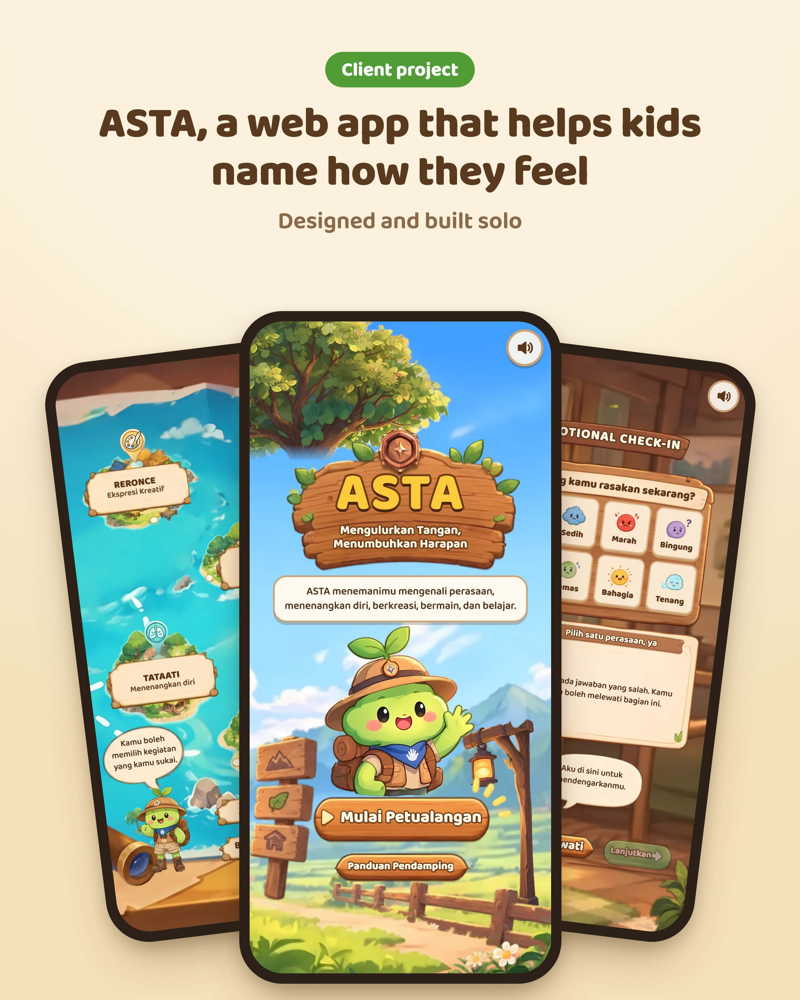
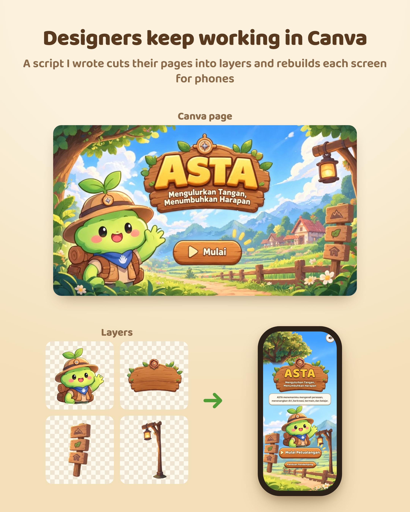

# ASTA

A mobile-first, game-style web app for children's emotional wellbeing. Kids check in with how they feel, then pick something to do about it: breathe, draw, play or learn.

*Mengulurkan Tangan, Menumbuhkan Harapan*

<p>
  
  
</p>

More screens are in [linkedin-post/](linkedin-post/).

## How a session flows

Home → greeting → emotional check-in (optional) → a suggestion → one of four islands on the map → closing, where the child chooses to keep going, rest, or ask an adult for company.

The islands:

- **Tataati:** guided breathing.
- **Reronce:** draw or tell how you feel.
- **Srawung:** a facilitator-led animal card game (32 cards).
- **Titen:** a 10-question quiz drawn from a 48-question bank.

## Design decisions

The app runs on shared tablets, so it saves nothing between sessions. Visited islands live in React state only, and the next child starts fresh.

Kids can skip the check-in, and the screens say there are no wrong answers. A wrong quiz answer plays a soft "try again" tone instead of a buzzer.

The adult running the session has a companion guide inside the app (Panduan Pendamping), reachable from Home and the map.

All on-screen copy lives in [src/content.json](src/content.json), separate from the code. Any copy written for the web build that wasn't in the original design is marked `"draft": true` so the content team can review it.

## Art pipeline

The designers work in Canva. [art/extract.py](art/extract.py) pulls each art layer out of a Canva PDF page at native resolution and skips rasterized text. [scripts/build-art.mjs](scripts/build-art.mjs) converts the layers in `art/export/` to WebP and writes [src/manifest.json](src/manifest.json), which places each layer on a fixed 900×1600 (portrait) or 1600×900 (landscape) frame. The build also detects which edges of each image are cut flat, so bushes along the frame stretch to the screen edge on tall phones while free-standing art stays put.

`art/export/` is the source of truth for art.

## Running it

```bash
npm install
npm run dev
```

Other scripts: `npm run build` (type-check and build to `dist/`) and `npm run art` (rebuild WebP art and the manifest from `art/export/`).

In dev, `?scene=<name>` jumps straight to a screen, for example `?scene=titen` or `?scene=closing&step=rest`.

## Stack

React 19, TypeScript, Vite, Motion for animation, Howler.js for audio, and sharp for the art build. The Python art scripts use PyMuPDF, Pillow and OpenCV.

Music and sound effects are CC0. Sources are listed in [AUDIO.md](AUDIO.md).
